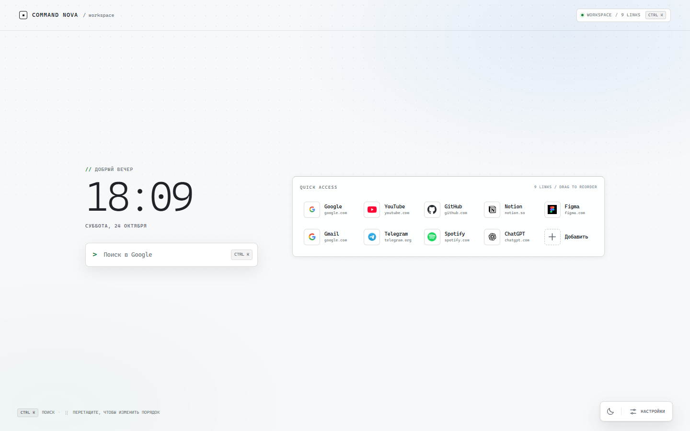
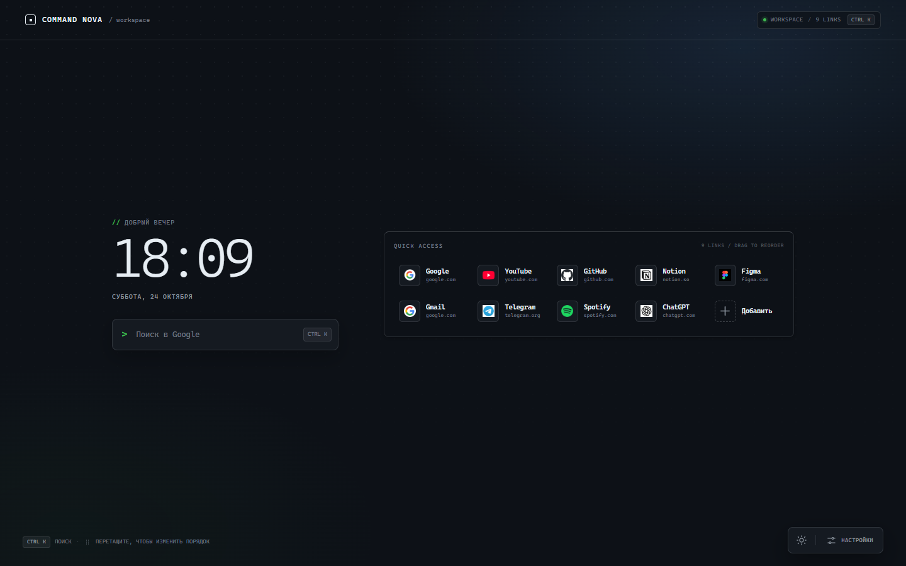
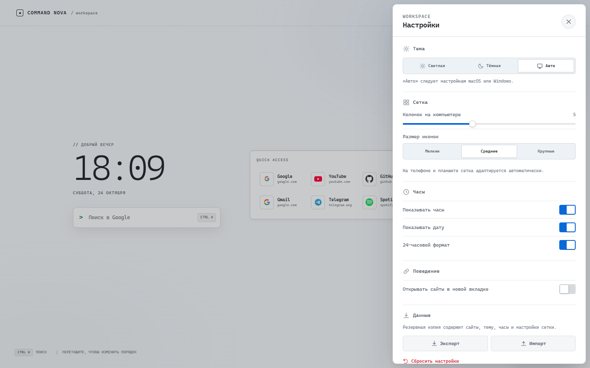
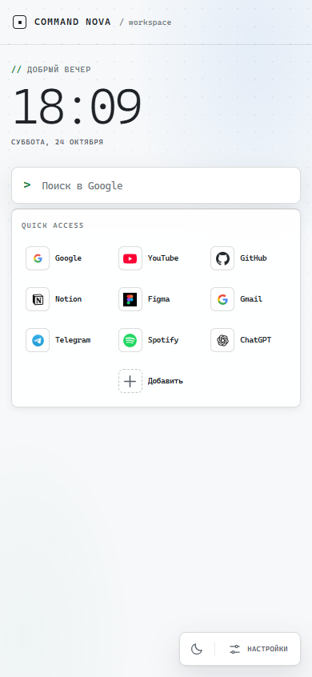

# Command Nova — Developer / Productivity UI

Рабочая новая вкладка для **Firefox** (основной target) и **Chrome / Chromium**. Единственный интерфейс — **Developer / Productivity**: рабочая панель быстрого доступа, компактные карточки сайтов, моноширинная типографика, статус-бар и спокойная нейтральная подложка без обоев.

| Светлая тема | Тёмная тема |
|:---:|:---:|
|  |  |

| Настройки | Мобильная версия |
|:---:|:---:|
|  |  |

## Что умеет

- **Поиск Google** — Enter, фокус по `Ctrl K` / `⌘ K` и `/`.
- **Живые часы и дата** на русском, 12/24-часовой формат, можно скрыть.
- **Quick Access** — компактные карточки сайтов с названием и доменом.
- **Управление сайтами** — добавление, редактирование, удаление с Undo и drag-and-drop сортировка мышью или с клавиатуры.
- **Автоматические favicon** с резервным источником и буквенной заглушкой, если интернета нет.
- **Developer-раскладка** — часы и поиск слева, панель ссылок справа, моноширинные подписи и статус-бар.
- **Собственная нейтральная подложка** — статичный градиент и точечная сетка, без обоев и без тяжёлого live-blur.
- **Темы** — светлая, тёмная и автоматическая (по системе).
- **Настройка сетки** — 3–8 колонок на компьютере, три размера иконок; на мобильных сетка адаптируется.
- **Автосохранение** каждого изменения в `localStorage`.
- **Импорт и экспорт** настроек в JSON, сброс к исходному состоянию.
- **Синхронизация** между несколькими открытыми новыми вкладками.
- **Доступность** — клавиатурная навигация, focus-trap в диалогах, `prefers-reduced-motion`, корректные ARIA-роли.
- **Без разрешений, аналитики и серверной части.**

## Производительность

- Интерфейс не использует живые `backdrop-filter`-слои, тяжёлые обои и бесконечные фоновые анимации.
- Часы перерисовываются раз в минуту, а не каждую секунду.
- Иконки сайтов не создают отдельный blur-слой каждая.
- Drag-and-drop определяет цель по позиции курсора, поэтому карточка не прыгает на ряд ниже; автоскролл отключён.
- На мобильных и при `prefers-reduced-transparency` фоновые эффекты остаются статичными.

## Установка в Firefox

В репозитории уже есть готовая сборка: **`dist-firefox/`**.

### Быстрый способ: временное расширение

1. Откройте `about:debugging#/runtime/this-firefox`.
2. Нажмите **«Загрузить временное дополнение…»** (Load Temporary Add-on).
3. Выберите файл **`dist-firefox/manifest.json`**.
4. Откройте новую вкладку.

> Временное дополнение действует до перезапуска Firefox. Перед удалением сделайте экспорт настроек: «Настройки» → «Данные» → «Экспорт».

### Постоянная установка

Обычный Firefox устанавливает только подписанные дополнения.

**A. Подписать через AMO (рекомендуется)**

1. Загрузите `release/command-nova-firefox-unsigned.zip` в [AMO Developer Hub](https://addons.mozilla.org/developers/).
2. Выберите распространение **«On your own» / Unlisted**.
3. Скачайте подписанный `.xpi` после проверки.
4. Откройте его в Firefox.

**B. Firefox Developer Edition / Nightly**

Включите `xpinstall.signatures.required = false` в `about:config` и установите `release/command-nova-firefox-unsigned.xpi` через `about:addons` → шестерёнка → **Install Add-on From File…**. В стабильном Firefox эта настройка не действует.

### Разработка в Firefox

```bash
npm install
npm run build:firefox
npx web-ext run --source-dir dist-firefox
```

Или загрузите `dist-firefox/manifest.json` через `about:debugging`. Для живого просмотра интерфейса используйте `npm run dev`.

## Установка в Chrome / Chromium

1. Откройте `chrome://extensions`.
2. Включите **режим разработчика**.
3. Нажмите **«Загрузить распакованное расширение»**.
4. Выберите папку **`dist`** (Manifest V3) или распакуйте `release/command-nova-chrome.zip`.
5. Откройте новую вкладку.

Если новую вкладку переопределяет другое расширение, отключите его. Chrome-сборка не требует разрешений и не использует service worker.

## Как пользоваться

- **Поиск** — введите запрос и нажмите Enter.
- **Добавить сайт** — кнопка «Добавить» в конце сетки.
- **Изменить / удалить** — наведите на карточку и нажмите `⋯` справа сверху, либо кликните правой кнопкой.
- **Сортировка** — потяните за маркер `⠿` слева сверху. С клавиатуры: сфокусируйте маркер, Space, стрелки, Space.
- **Настройки** — кнопка в правом нижнем углу: тема, сетка, часы, поведение, импорт/экспорт.
- **Быстрая смена темы** — кнопка солнца/луны в доке.

## Технологии и структура

- **React 18 + TypeScript + Vite**
- **@dnd-kit** для доступной drag-and-drop сортировки
- CSS с токенами, светлой/тёмной темой и Developer-раскладкой
- Manifest V3 для Chrome, Manifest V2 для Firefox
- Без UI-фреймворков, внешних шрифтов и фавикон-библиотек

```
src/
  App.tsx                 состояние, горячие клавиши, сценарии
  components/
    Clock.tsx             часы и дата
    SearchBar.tsx         поиск Google
    SiteGrid.tsx          сортируемая сетка и drag-and-drop
    SiteDialog.tsx        добавление / редактирование сайта
    TileMenu.tsx          контекстное меню
    SettingsPanel.tsx     тема, сетка, часы, данные
    Toast.tsx             уведомления с Undo
  storage.ts              валидация, автосохранение, импорт/экспорт
  styles.css              Developer UI, темы, адаптивность
firefox/manifest.json     Manifest V2 для Firefox
public/manifest.json      Manifest V3 для Chrome
public/icons/             иконки 16–128 px
scripts/build-firefox.mjs копирование сборки и Firefox-манифеста
dist/                     готовая Chrome/Chromium-сборка
dist-firefox/             готовая Firefox-сборка
release/                  ZIP/XPI-архивы
```

## Команды

```bash
npm install             # зависимости
npm run dev             # Vite-разработка (http://localhost:5173)
npm run typecheck       # проверка TypeScript
npm run build           # собрать Chrome + Firefox
npm run build:chrome    # только dist/
npm run build:firefox   # dist/ + dist-firefox/
npm run preview         # предпросмотр production-сборки
npm run test:ui         # e2e-проверки (нужен запущенный npm run preview)
```

`npm run test:ui` использует установленный Google Chrome. При необходимости задайте путь: `CHROME_PATH=/path/to/chrome npm run test:ui`.

## Проверено

- ✅ `npm run typecheck` и production-сборка без ошибок.
- ✅ 30 e2e-проверок в Chromium: поиск, точный drag-and-drop, темы, Developer-раскладка, сетка, импорт/экспорт, reset, add/edit/delete/undo, сохранение после перезагрузки, мобильная вёрстка, Developer-only интерфейс без обоев.
- ✅ Firefox: временная установка и new-tab override (`moz-extension://…/index.html`), отрисовка без горизонтального скролла; `web-ext lint` — 0 ошибок.
- ✅ Chrome: manifest успешно упакован Chrome (`--pack-extension`).

## Приватность и ограничения

- Настройки хранятся только в `localStorage` браузера.
- Favicon запрашиваются у Google (`google.com/s2/favicons`) с резервным DuckDuckGo. Это единственные внешние запросы, кроме самого поиска.
- Обои и внешние фоновые изображения не используются.
- Для постоянной установки в стабильный Firefox нужна подпись AMO — ограничение Mozilla.
- Используется системная типографика; проприетарные шрифты и брендовые ассеты не поставляются.

## Лицензия

MIT — см. [LICENSE](LICENSE).
